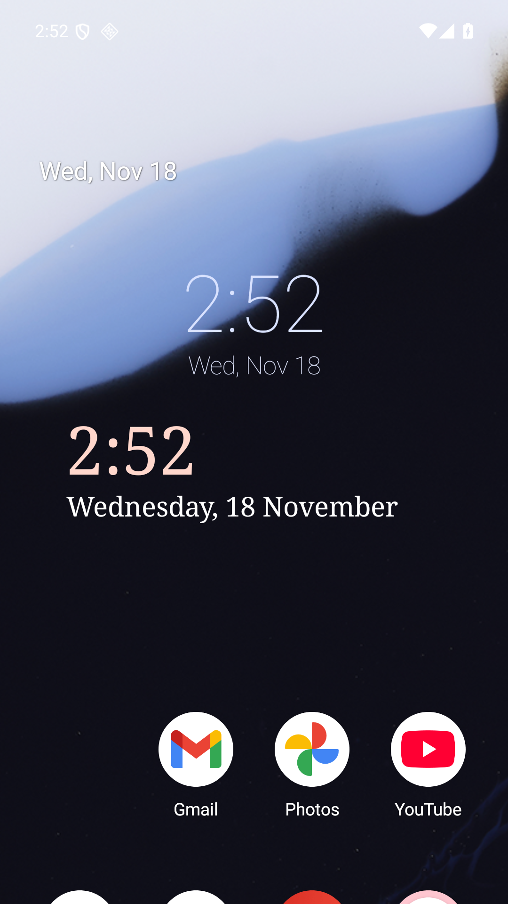
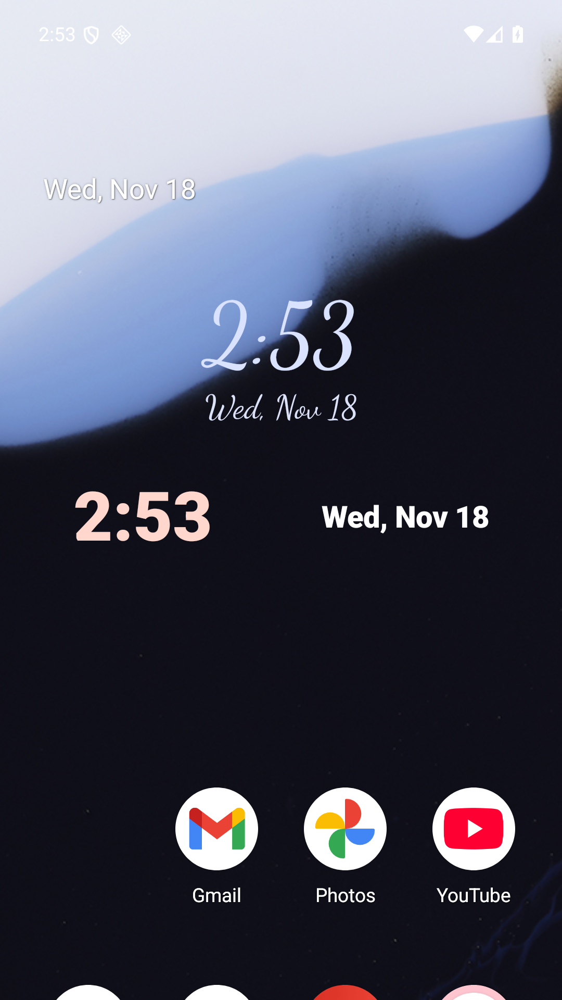
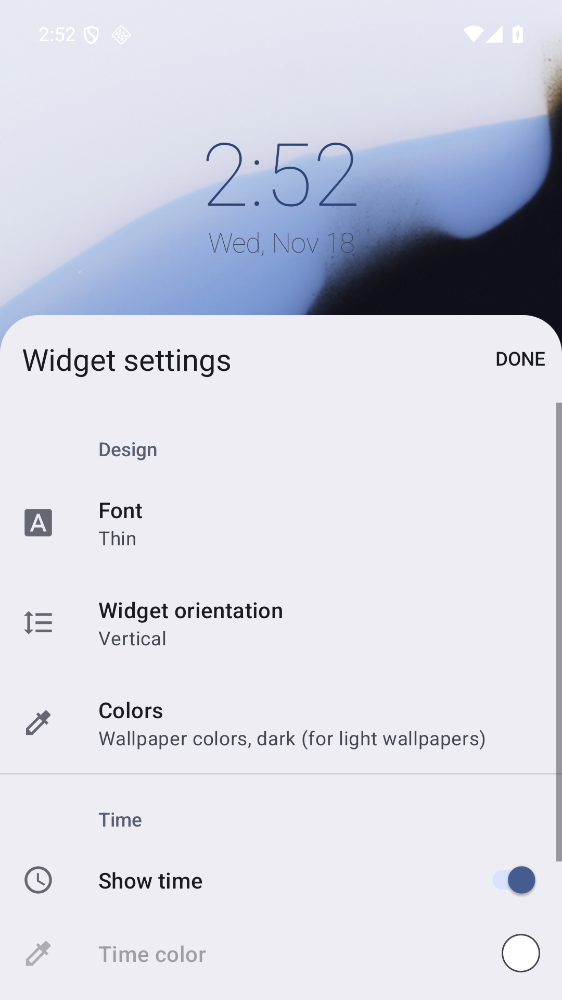
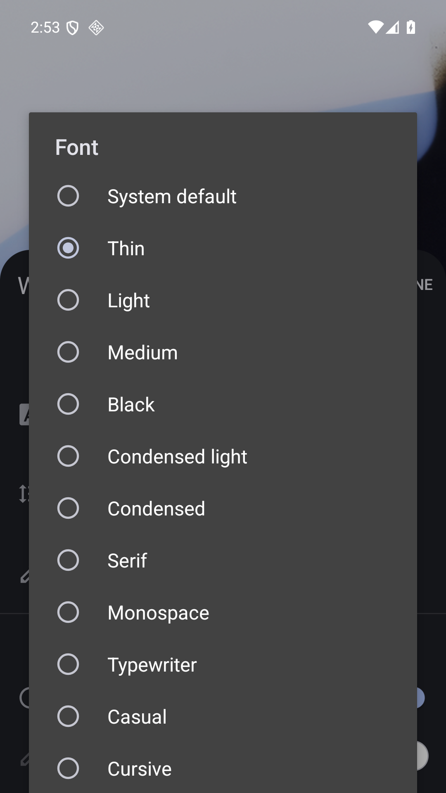

# Material Clock & Date Widget

A digital clock and date widget for Android home screens. No ads, no tracking, no permissions.

<a href="https://play.google.com/store/apps/details?id=xyz.yoav.materialclock">Get it on Google Play</a>

  
  
  
  

## Features

Each widget on your home screen has its own settings:

- 13 font styles: thin, light, medium, black, condensed, serif, monospace, typewriter, casual, cursive, small caps and more
- Size, color and alignment for the time and the date, separately
- Wallpaper colors on Android 12 and later, which follow your wallpaper when it changes
- Vertical or horizontal layout, either way round
- Custom time and date formats, or your phone's 12/24-hour setting

The settings screen previews the widget over your real wallpaper.

Requires Android 8.0 or later. Wallpaper colors need Android 12.

## Using it

There is no app screen, only the widget. Long-press an empty spot on your home screen, tap Widgets and look for MaterialClock. To change a widget later, long-press it and tap its edit button.

## Why built-in fonts only

Versions 1.0.x bundled their own font files. Android 12 and later ignore an app's bundled fonts when a widget is drawn on the home screen, so those fonts silently fell back to the default. The font list now uses the font families built into Android, which widgets are allowed to use. Widgets set to an old font move to the closest built-in one on upgrade.

## Building

    ./gradlew assembleDebug

Needs JDK 17 or later.

Release builds are signed when `keystore.properties` exists at the repo root (it is gitignored):

    storeFile=/path/to/keystore.jks
    storePassword=...
    keyAlias=...
    keyPassword=...

Then:

    ./gradlew bundleRelease

The widget layouts are generated, one per font. Edit `scripts/generate_widget_layouts.sh` and rerun it rather than editing `widget_layout_*.xml` by hand.

Play Store text and screenshots live in `fastlane/metadata/android/`.

## Contributing

Pull requests are welcome.

## License

GPL-3.0, see [LICENSE](LICENSE). App icon by [monkik](https://www.flaticon.com/authors/monkik).
